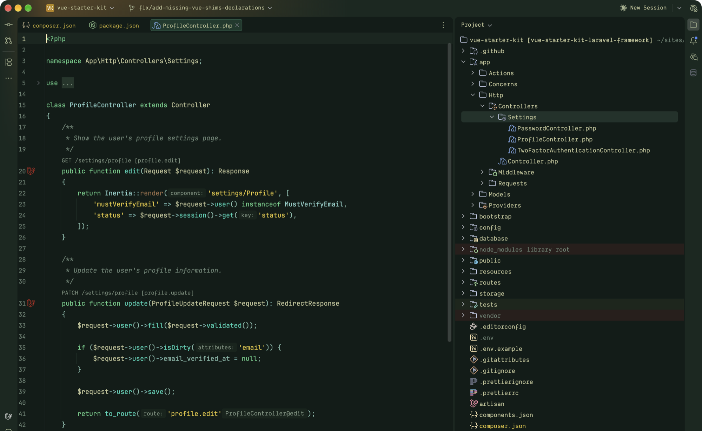
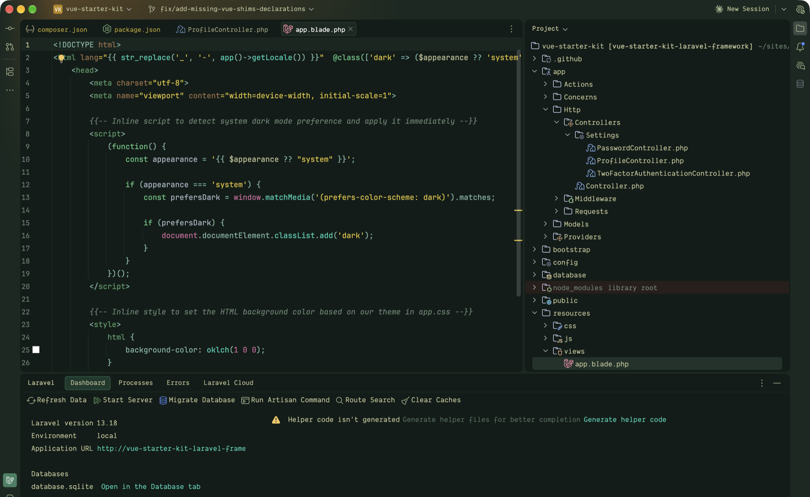

# Osaka Jade for PhpStorm

A dark JetBrains theme built from [Omarchy's](https://omarchy.org) Osaka Jade palette. It keeps the rounded Islands layout from PhpStorm 2025.3 and later, and ships with a matching editor color scheme tuned for PHP, Laravel, Blade, JavaScript and CSS.





## Palette

| Role | Color |
|---|---|
| Background | `#111c18` |
| Foreground | `#C1C497` |
| Keywords | `#5ccd86` |
| Strings | `#E5C736` |
| Functions and methods | `#2DD5B7` |
| Classes and types | `#8CD3CB` |
| Properties and punctuation | `#81B8A8` |
| Numbers, constants and `$this` | `#D2689C` |
| Attributes and named arguments | `#a2734b` |
| Comments | `#6b8474` |

Comments, line numbers and secondary UI text are a little lighter than Omarchy's original `#53685B` so they stay readable on the dark green background.

## Install

You need PhpStorm 2026.2 or later (build 262+). Other JetBrains IDEs on the same build work too.

```bash
git clone https://github.com/joshdonnell/osaka-jade-phpstorm.git
cd osaka-jade-phpstorm
./build.sh
```

`build.sh` packs the plugin into `dist/osaka-jade-theme.jar` and copies it into the newest PhpStorm config folder (PhpStorm EAP first, then the stable release). Restart PhpStorm, then choose **Osaka Jade** in Settings, Appearance & Behavior, Appearance, Theme.

To install by hand instead, run `./build.sh --no-install` and add the jar through Settings, Plugins, the gear icon, Install Plugin from Disk.

## How it is built

`generate.py` reads the Islands Dark theme and editor scheme straight from your installed PhpStorm, then swaps every color for its Osaka Jade counterpart. That keeps every Islands setting (rounded panels, spacing, new UI keys) in step with the IDE you actually run. The generated files live in `src/themes` and are committed, so building without PhpStorm installed still works.

When JetBrains updates Islands, run `./build.sh` again to pick up the changes. To point it at a specific app, set `IDE_APP`:

```bash
IDE_APP="$HOME/Applications/PhpStorm.app" ./build.sh
```

To change a color, edit the palette and mappings at the top of `generate.py` rather than the generated files.

## Credits

The Osaka Jade palette comes from Omarchy's theme of the same name.

## License

MIT
